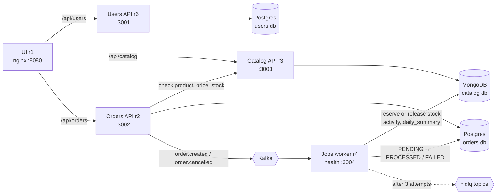

# ShopLite: infrastructure and UI tests

ShopLite is a small online shop split across seven repositories. It is built as a realistic target for testing
tools (such as CanaryQA): a web UI, three REST APIs, an asynchronous jobs worker, and three data stores
(**PostgreSQL**, **MongoDB**, **Kafka**).

This repo (**r5**) holds the `docker-compose` stack that runs everything, demo seed data, a Makefile, and the
Playwright UI tests.

## The repos

| Repo | What | Stack | Talks to |
|---|---|---|---|
| [r1](../r1) | **UI**: web shop and admin pages | React, Vite, nginx | all three APIs through `/api/*` |
| [r2](../r2) | **Orders API**: place, list and cancel orders | Express, TypeScript | Postgres, Kafka (producer), Catalog API |
| [r3](../r3) | **Catalog API**: products, stock, order activity, daily reports | Express, TypeScript | MongoDB |
| [r4](../r4) | **Jobs worker**: processes order events, builds daily summaries | Node, kafkajs | Kafka (consumer), Postgres, MongoDB |
| [r5](.) | **Infra and UI tests**: docker-compose, seed data, Playwright | Docker, Playwright | everything |
| [r6](../r6) | **Users API**: sign-up, login (JWT), users | Express, TypeScript | Postgres |
| [r7](../r7) | **API test suite**: black-box tests and a Postman/Newman collection | Vitest, Newman | all APIs |

## How it fits together



**An order's life**

1. `POST /orders` (Orders API) checks each product's price and stock with the Catalog API, saves the order as
   `PENDING` in Postgres and publishes `order.created` to Kafka.
2. The jobs worker consumes the event, waits `PROCESSING_DELAY_MS` (1.5 s here, so `PENDING` is visible), and
   reserves the stock in MongoDB for all lines or none.
3. On success the order becomes `PROCESSED`; if stock ran out in the meantime it becomes `FAILED` with
   `INSUFFICIENT_STOCK`. Every step is written to an activity timeline, served by `GET /activity?orderId=`.
4. Cancelling (`POST /orders/:id/cancel`) publishes `order.cancelled`. The worker returns the stock if it had
   been reserved.
5. Every `SUMMARY_INTERVAL_MS` the worker writes today's totals to MongoDB, served at `GET /reports/daily`.

Authentication is a JWT (HS256) issued by the Users API and checked by the Orders and Catalog APIs with the
shared `JWT_SECRET`.

## Quick start

> Full guide, covering local development with hot reload, checking the stack, resetting data, configuration and troubleshooting:
> **[docs/running-the-services.md](docs/running-the-services.md)**

Requirements: Docker with Compose v2, `make`, Node 22 (for running the tests).

```bash
# Clone all seven repos side by side
for r in r1 r2 r3 r4 r5 r6 r7; do git clone https://github.com/chanikya5791/$r; done
cd r5
make up          # builds and starts everything, waits until healthy, seeds demo data
```

Open http://localhost:8080. Accounts:

| Account | Email | Password |
|---|---|---|
| Admin | `admin@shoplite.local` | `Admin123!` |
| Demo customer | `demo@shoplite.local` | `Demo1234!` |

Other targets: `make ps`, `make logs`, `make seed`, `make down`, `make clean` (also deletes data). Run `make help`
for the full list.

If the repos are not side by side, copy `.env.example` to `.env` and set `UI_PATH`, `ORDERS_API_PATH`,
`CATALOG_API_PATH`, `JOBS_PATH` and `USERS_API_PATH`.

## Ports

| Service | URL |
|---|---|
| UI | http://localhost:8080 |
| Users API | http://localhost:3001 (OpenAPI: `r6/openapi.yaml`) |
| Orders API | http://localhost:3002 (OpenAPI: `r2/openapi.yaml`) |
| Catalog API | http://localhost:3003 (OpenAPI: `r3/openapi.yaml`) |
| Jobs worker health | http://localhost:3004/health |
| Postgres | `localhost:5432`, user `shoplite` / `shoplite`, databases `users` and `orders` |
| MongoDB | `mongodb://localhost:27017`, database `catalog` |
| Kafka | `localhost:9094`, topics `order.created`, `order.cancelled`, `order.created.dlq`, `order.cancelled.dlq` |

All ports can be changed in `.env`.

## Tests across the repos

| Level | Where | Needs | Run with |
|---|---|---|---|
| Unit tests | r1, r2, r3, r4, r6 | nothing | `npm run test:unit` (UI: `npm test`) |
| Integration tests (real Postgres, MongoDB and Kafka via Testcontainers, responses checked against `openapi.yaml`) | r2, r3, r4, r6 | Docker | `npm run test:integration` |
| Full-stack API tests | r7 | running stack | `make test-api` (here) or `npm test` in r7 |
| Postman / Newman collection | r7 | running stack | `npm run test:newman` in r7 |
| UI tests (Playwright) | r5 `e2e/` | running stack | `make test-e2e` |

`make test-all` runs the API and UI suites against the running stack.

### Playwright UI tests (`e2e/`)

```bash
make up
cd e2e && npm ci && npx playwright install chromium && npx playwright test
```

Set `UI_URL` to test a different deployment. The tests create their own users and products (with unique SKUs),
so they can run in parallel and repeatedly against the same stack. Covered:

- Guest browsing, search and category filters, protected-route redirect, health of every service through the proxy
- Sign-up, log-out and log-in, including a wrong-password error
- Placing an order and watching it become `PROCESSED` with its activity timeline; stock goes down
- Cancelling a processed order returns the stock
- A stock error at checkout when stock runs out in the meantime; out-of-stock products cannot be added
- Admin product create, edit and delete; duplicate SKU error; customers cannot see admin pages; the daily report

## CI

- `.github/workflows/ci.yml` validates the compose file and type-checks the Playwright tests.
- `.github/workflows/full-stack.yml` checks out all seven repos at the same branch, runs `make up`, then runs the
  r7 API tests, the Newman collection and the Playwright tests. If the repos are private, add a
  `SHOPLITE_REPOS_TOKEN` secret with read access to all of them.
